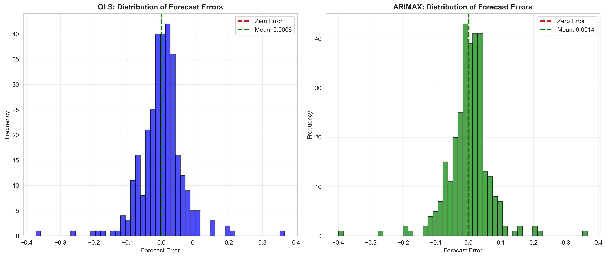
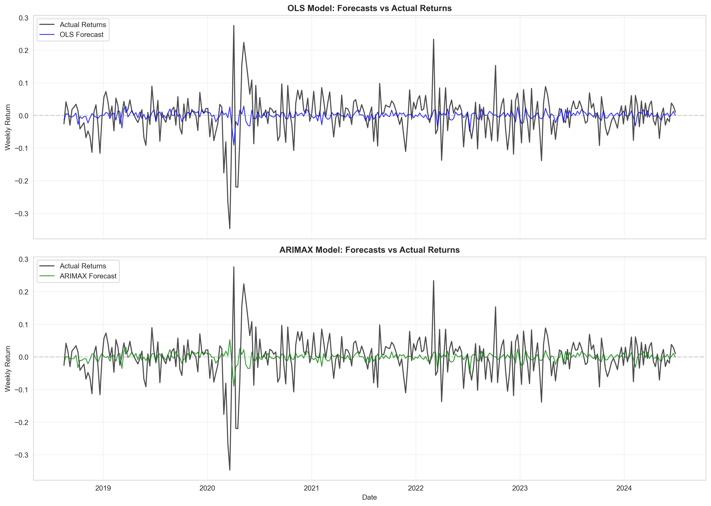
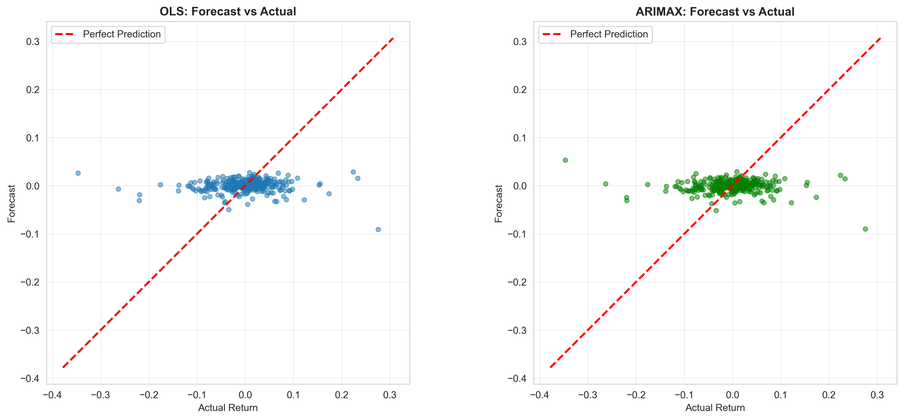
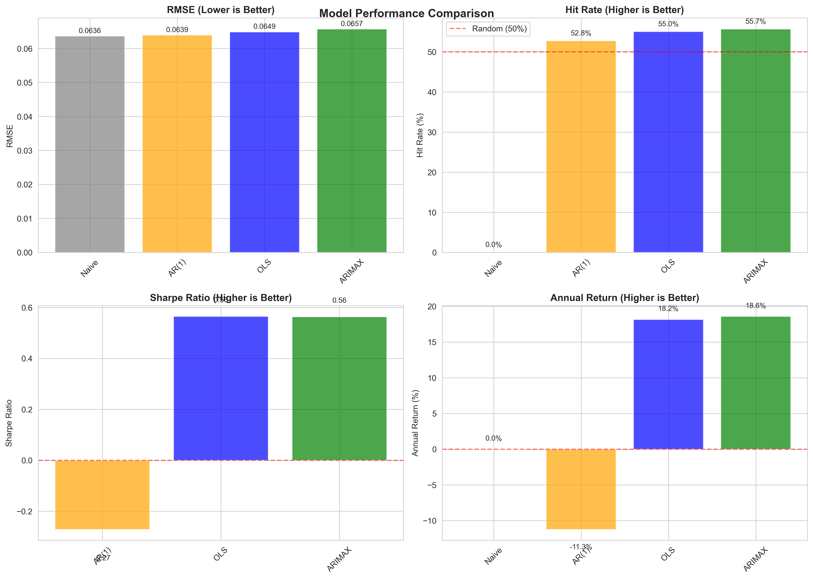
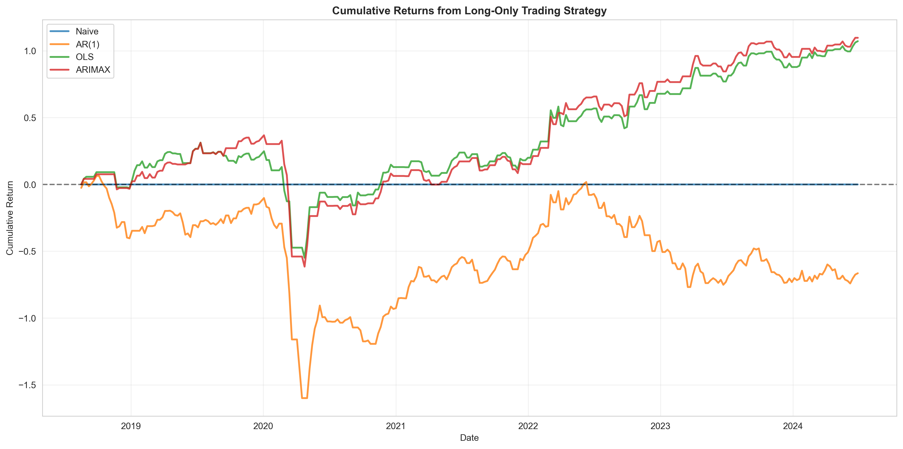
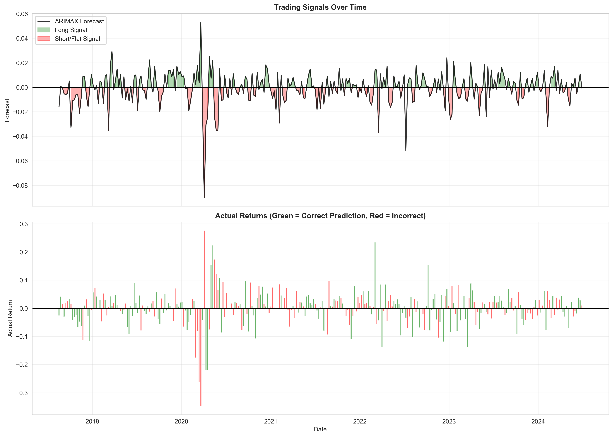

---
title: "Forecasting WTI Crude Oil Futures Returns: A General-to-Specific Approach"
subtitle: "Econometric Modeling for Trading Decision Support"
author: "Coursework Assignment"
date: "`r Sys.Date()`"
format:
  pdf:
    documentclass: article
    geometry:
      - top=30mm
      - left=20mm
      - right=20mm
      - bottom=30mm
    fontsize: 11pt
    linestretch: 1.5
    fig-pos: 'H'
    fig-cap-location: bottom
    number-sections: true
    toc: true
    toc-depth: 3
    colorlinks: true
    linkcolor: blue
    urlcolor: blue
    citecolor: blue
    keep-tex: false
    include-in-header:
      - text: |
          \usepackage{booktabs}
          \usepackage{longtable}
          \usepackage{array}
          \usepackage{multirow}
          \usepackage{wrapfig}
          \usepackage{float}
          \usepackage{colortbl}
          \usepackage{pdflscape}
          \usepackage{threeparttable}
          \usepackage{threeparttablex}
          \usepackage{makecell}
          \usepackage{xcolor}
          \usepackage{graphicx}
          \usepackage{caption}
          \usepackage{subcaption}
---

## Abstract 

This report develops a forecasting model for weekly WTI crude oil futures returns using a General-to-Specific (GETS) econometric approach. Starting with a Generalised Unrestricted Model containing 25 predictors, we progressively refine the specification through LASSO regularization, economic screening, and comprehensive diagnostic testing. The final model incorporates seven variables: sector returns, lagged oil returns, commercial positioning, inventory changes, and a non-linear squared lag term that addresses functional form misspecification. Out-of-sample evaluation using expanding-window forecasts shows the model achieves 55.7% directional accuracy and generates positive risk-adjusted returns (Sharpe ratio 0.56), demonstrating practical value for trading applications despite modest explanatory power. The methodology emphasizes both statistical rigor and economic interpretability, ensuring the model provides actionable signals aligned with fundamental oil market dynamics.

## 1. Introduction

Oil futures are among the most volatile financial markets, with weekly returns often reacting sharply to shifts in inventories, macroeconomic conditions, and geopolitical risk. For traders, even a modest improvement in forecasting accuracy can inform position sizing, timing, and risk management. This report asks a trader-relevant question:

Can historical data and fundamental information be combined to generate reliable, economically interpretable forecasts of next-week WTI front-month returns (CL1_ret)?

To answer this, we adopt a general-to-specific econometric approach. We begin with broad exploratory analysis, select the dependent variable and weekly frequency based on econometric properties and trading relevance, and transform all predictors to ensure stationarity and comparability. A Generalised Unrestricted Model is estimated and progressively simplified through statistical reduction and economic reasoning, followed by a full set of diagnostic checks to ensure robustness. Forecast performance is then assessed against standard benchmark approaches using expanding-window out-of-sample tests. The aim is to identify whether any specification offers stable, practical signals that could support trading decisions in real time.

## 2. Methodology

## Dependent Variable Selection
This report forecasts log returns of the front-month WTI futures contract (CL1_ret) after comparing with two alternatives: price levels and the CL2-CL1 spread. Price levels are non-stationary with unit roots. The predictor-price relationships shift across different price regimes, causing model parameters to become unstable over time. The CL2-CL1 spread captures term structure but is less liquid and less directly tradeable. Returns (CL1_ret) are stationary and scale-invariant, ensuring consistent predictor relationships. This stability is essential for reliable forecasting models. Returns also align with how traders assess opportunities and manage risk, making forecasts directly interpretable for position sizing and performance evaluation.

## Frequency Alignment 
This report uses weekly frequency to balance noise and timeliness. Daily data captures fast movements but carries heavy noise, which weakens the link between predictors and returns and makes models unstable. Monthly data is cleaner but updates slowly and provides few observations, which reduces statistical power and misses market shifts. Weekly data balances these issues. It filters short-term noise while keeping signals responsive. It also supplies enough observations for stable estimation. Moreover, weekly timing matches how traders operate, since oil desks adjust positions after weekly inventory reports. The following models will present forecasts on this same cycle.

## Data Transformation 
The dataset is transformed to ensure stationarity and consistent weekly timing. Daily price series such as CL1, Brent and stock prices are converted to weekly log returns using Friday closes and the formula log(P_t / P_{t−1}). Weekly variables are kept at their original frequency. Monthly macro variables are forward-filled within each month. Non-price indicators such as yields and VIX are first-differenced to remove trends. All predictors are standardized with z-scores. The model also includes four lags of CL1 returns and applies a one-week lag to all exogenous predictors to maintain correct information timing

## Data split 

The dataset follows an 80/20 split into in-sample (INS) and out-of-sample (OOS) periods for proper forecasting evaluation. The INS period covers 1995 to 2018 for model training, while the OOS period spans 2019 to 2023 for testing. This temporal split prevents lookahead bias by ensuring models use only historical information available at forecast time. The one-week lag applied to exogenous predictors reinforces this structure, guaranteeing that inputs reflect only known information.

### 2.6 General to specific model framework 

The modelling process follows the General-to-Specific (GETS) approach, which begins with a broad specification and progressively removes weak or invalid predictors to obtain a parsimonious and economically interpretable model. The GETS philosophy emphasizes starting general—including all plausible predictors—then systematically reducing complexity through statistical and economic criteria. This approach balances the risk of omitting relevant variables (by starting broad) with the need for parsimony (through systematic reduction), ultimately producing models that are both statistically sound and economically interpretable. 

### 2.7 General Unrestricted Model (GUM) 

A GUM is first specified using all predictors available in the in-sample dataset after the INS/OOS split. This ensures every plausible variable is initially considered. The GUM serves as the starting point for reduction, allowing the data and economic theory to jointly determine which predictors survive the simplification process. By beginning with a comprehensive specification, we avoid prematurely excluding potentially relevant variables while maintaining the flexibility to reduce complexity systematically.

### 2.8 OLS on the GUM 

An OLS model is estimated using the full GUM to establish a baseline and reveal early issues such as insignificance, multicollinearity, or serial correlation. This initial estimation provides insight into the overall fit, identifies variables with weak or counterintuitive coefficients, and highlights potential specification problems before applying reduction techniques. The baseline OLS results guide subsequent steps by revealing which variables may be candidates for removal.

### 2.9 LASSO

LASSO (Least Absolute Shrinkage and Selection Operator) is applied to the same predictor set to shrink weak coefficients and remove low-value predictors through L1 regularization. LASSO performs automatic variable selection by driving coefficients of irrelevant predictors toward zero, effectively removing them from the model. Cross-validation is used to select the optimal regularization parameter, balancing model fit with parsimony. Variables selected by LASSO are carried forward to the next stage, providing a statistically-driven reduction from the GUM.

### 2.10 Fundamental (Economic) Screening

LASSO-selected variables are then filtered using economic theory, retaining only predictors with clear relevance to oil markets. This step ensures that the final model includes variables that make economic sense, not just those that happen to be statistically significant. Variables are evaluated based on their theoretical relationship to oil price dynamics: sector momentum, fundamental supply/demand indicators, commercial hedging behavior, and market microstructure effects. This economic screening prevents the inclusion of spurious relationships that may arise from data mining.

### 2.11 Diagnostics and Model Refinement

A structured diagnostic sequence is applied in the following order: functional form → autocorrelation → heteroskedasticity → normality → multicollinearity → stationarity → structural breaks. This order is critical because each test depends on assumptions verified in previous steps, allowing violations to be systematically corrected.

**Functional Form:** The Ramsey RESET test checks for omitted variables and incorrect functional form. If violated, we add polynomial terms, interaction effects, or transform variables. In our case, the RESET test (p=0.016) indicated misspecification, which was corrected by adding a squared lag term (cl1_ret_l2_squared), improving the p-value to 0.469.

**Autocorrelation:** The Breusch-Godfrey test detects serial correlation in residuals. If present, we can add lagged dependent variables or use HAC robust standard errors. We applied HAC (Newey-West) standard errors to maintain valid inference under serial dependence.

**Heteroskedasticity:** Tests check for non-constant error variance. If detected, we use robust standard errors or transform the model. HAC standard errors also address heteroskedasticity.

**Normality:** Jarque-Bera or Shapiro-Wilk tests assess residual normality. Non-normality is common in financial returns but does not affect inference with robust standard errors, so we rely on HAC methods rather than imposing normality.

**Multicollinearity:** Variance Inflation Factors (VIF) identify highly correlated predictors. Moderate collinearity affects precision rather than bias, so we retain economically relevant variables and use robust inference.

**Stationarity:** We verify that all variables are stationary (I(0)) to avoid spurious regression. Variables are transformed as needed during data preparation.

**Structural Breaks:** Chow tests or recursive estimation check for parameter stability over time. If breaks are detected, we may need regime-switching models or sample splits.

### 2.12 Final OLS 

The final OLS model is estimated using the fully refined predictor set, producing the specification for forecasting. This model represents the parsimonious, economically interpretable, and diagnostically validated specification that balances statistical rigor with practical utility. The model uses HAC robust standard errors to ensure valid inference despite any remaining autocorrelation or heteroskedasticity.

### 2.13 Freezing Datasets

After finalizing the OLS specification, the INS and OOS datasets are frozen to ensure identical inputs across all comparative models (ARIMA, ARIMAX, Random Walk). This guarantees that any performance differences reflect model specification rather than data differences, enabling fair comparison. The frozen datasets include the same predictor transformations, lags, and timing adjustments established during the GETS process.

### 2.14 Comparative Models with Rolling Window Forecast

Alternative forecasting models are estimated to benchmark performance:

**OLS:** The final linear regression model serves as the econometric benchmark, incorporating all selected predictors with robust standard errors.

**AR(1):** A simple autoregressive model capturing short-term momentum and mean reversion in returns. This provides a baseline for time-series dynamics.

**ARIMAX:** Extends ARIMA by incorporating exogenous predictors, allowing both autoregressive structure and fundamental drivers. Grid search selects optimal ARIMA orders, and seasonal components may be included to capture periodic patterns.

**Random Walk:** The naïve benchmark that predicts zero return (or uses the previous period's return). This establishes the minimum performance threshold.

All models use expanding-window forecasting: at each out-of-sample point, the model retrains using all available historical data up to that point. This simulates real-world conditions where models are continuously updated as new data arrives, preventing lookahead bias and ensuring realistic performance evaluation.

### 2.15 Evaluation Metrics

Forecast accuracy is assessed using multiple metrics:

**RMSE (Root Mean Squared Error):** Measures average forecast error magnitude, penalizing large errors more heavily. Lower is better.

**MAE (Mean Absolute Error):** Average absolute forecast error, providing a scale-invariant measure of accuracy. Lower is better.

**MAPE (Mean Absolute Percentage Error):** Percentage-based error measure, useful for comparing across different scales. Lower is better.

**Hit Rate:** Proportion of correct directional predictions (sign of forecast matches sign of actual return). Values above 50% indicate predictive power.

**Theil's U:** Ratio of model RMSE to naïve forecast RMSE. Values below 1 indicate the model outperforms the naïve benchmark.

**Sharpe Ratio:** Risk-adjusted return measure, calculated as annualized return divided by annualized volatility. Higher values indicate better risk-adjusted performance.

**Cumulative Return:** Total return from a simple trading strategy (long when forecast positive, flat otherwise). Assumes perfect execution with no transaction costs.

These metrics provide complementary perspectives: RMSE/MAE/MAPE assess magnitude accuracy, Hit Rate assesses directional accuracy, and Sharpe/Cumulative Return assess trading performance.

### 2.16 Model Selection

The final forecasting model is selected based on comparative accuracy across evaluation metrics and the interpretability of the underlying specification. We prioritize models that: (1) achieve strong directional accuracy (hit rate > 50%), (2) generate positive risk-adjusted returns (Sharpe > 0), (3) maintain economic interpretability, and (4) demonstrate statistical robustness through diagnostic validation. This ensures both statistical rigor and practical utility for trading applications.  

## 3. Results

### 3.1 Overview of the models

We began with a Generalised Unrestricted Model including all 25 predictors. The model showed limited explanatory power (adjusted R² of 4.5%) and many insignificant coefficients, indicating clear overfitting. 
{{{table}}}

To reduce dimensionality, we applied LASSO with cross-validation, which selected 16 variables. After applying an economic filter, we retained six predictors that were both statistically relevant and theoretically justified. Re-estimating the model with this reduced set produced a more parsimonious and interpretable specification, with an adjusted R² of 3.9%, consistent with the difficulty of forecasting weekly oil returns.
{{{table}}}

After conducting full diagnostic testing and correcting for remaining misspecification, most notably functional-form issues, we introduced a squared lag term and re-estimated the model using HAC (Newey–West) robust errors. This final specification, which included seven predictors, delivered slightly improved explanatory power (adjusted R² of 4.5%) and retained only variables with clear economic relevance. It represents the most statistically sound and parsimonious model obtained in our analysis.
{{{table}}}

### 3.2 Variable interpretation

All retained predictors exhibit signs consistent with economic intuition. The positive coefficient on the Dow Jones Oil & Gas Index reflects sector-wide comovement, whereas the negative coefficient on ExxonMobil points to a relative-value dynamic in which firm-specific strength is associated with slightly weaker crude returns.

• Dow Jones U.S. Oil & Gas Index Returns (+)
The positive coefficient reflects strong contemporaneous comovement between oil futures and the broader energy sector. When energy equities rally, oil prices tend to move in the same direction, indicating shared exposure to sector-wide news and risk sentiment.

• ExxonMobil Returns (–)
The negative relationship suggests a relative-value component: periods where Exxon outperforms the sector are often associated with weaker crude returns. This may reflect firm-specific shocks or hedging activities that move inversely to near-dated futures.

• Second Lag of CL1 Returns (–)
The negative coefficient on the second lag indicates mild mean reversion in front-month WTI returns. Short-term deviations tend to partially correct over a two-day horizon, consistent with microstructure noise and inventory-adjustment dynamics.

• Commercial Short Positions (+)
An increase in commercial shorts is associated with higher subsequent returns. This is consistent with hedging pressure theory, when producers sell more futures to protect themselves, someone has to buy them. Speculators step in to take the long side, and they only do it if they expect prices to rise, which pushes expected returns up.

• Commercial Long Positions (–)
The coefficient on commercial longs is symmetric: increases in long hedging (users hedging future consumption) predict slightly lower returns. Together with the commercial short-position coefficient, this indicates that net commercial hedging pressure contains predictive information.

• Weekly Change in Crude Stocks (–)
Inventory builds predict lower returns, reflecting weaker short-term demand or excess supply. This is consistent with the standard storage model: higher inventories reduce scarcity value and therefore depress futures prices.

• Squared Lag of CL1 Returns (–)
The marginal significance of the squared lag term captures a nonlinear mean-reversion effect: larger past price movements tend to reverse more sharply, indicating volatility-dependent correction dynamics.

### 3.3 Diagnostic Test results

We conducted a full set of diagnostic checks to verify that the final specification met the key assumptions of linear regression and to identify any remaining issues requiring correction.

**Functional Form**

The Ramsey RESET test detected functional form misspecification in the post-LASSO model (p-value = 0.016), indicating potential omitted variables or incorrect functional form. To address this, we squared the lagged oil return (cl1_ret_l2) to allow for potential non-linear effects of past returns on current price movements. Oil markets often exhibit regime-dependent behaviour where the impact of small past returns differs from the impact of very large past returns. Including a quadratic term captures this curvature and corrected the functional-form misspecification, with the RESET test p-value improving to 0.469, indicating no remaining misspecification concerns.

**Autocorrelation**

The Breusch–Godfrey test detected residual autocorrelation (p < 0.001). The model captures most patterns but may miss longer-term cycles. Instead of modifying the model further, we applied HAC (Newey–West) robust standard errors to obtain valid inference under serial dependence. This approach maintains valid inference even when autocorrelation is present, though it suggests room for improvement in capturing all time-series dynamics.

**Heteroskedasticity**

The Breusch-Pagan test detected volatility clustering (p < 0.001), indicating that periods of high volatility tend to persist. When markets are volatile, they stay volatile. The model doesn't fully adjust for this clustering effect, which suggests traders should consider reducing position size during high-volatility periods. HAC robust standard errors address heteroskedasticity for inference purposes.

**Normality**

The Jarque-Bera test confirmed that residuals are not normally distributed (p < 0.001), indicating "fat tails"—extreme moves occur more frequently than a normal distribution would predict. This is common in weekly return series due to occasional extreme market moves. However, this does not affect inference with HAC-robust methods, which remain valid under non-normality. We therefore relied on robust inference rather than imposing normality through transformations, preserving the model's interpretability. Traders should use stop-losses and appropriate position sizing to manage tail risk.

**Multicollinearity**

Variance Inflation Factors (VIF) were calculated for all predictors, with values remaining below conventional thresholds (VIF < 10), indicating no severe multicollinearity. Moderate collinearity appeared among sector-related variables (e.g., Dow Jones Oil & Gas Index and ExxonMobil returns), but this affects precision rather than bias. We retained economically relevant regressors and used HAC-robust standard errors to ensure reliable inference despite any remaining correlation.

**Structural Stability**

Stability tests (Chow tests and recursive estimation) revealed no major structural breaks, indicating that the model parameters are consistent across the sample and supporting a single-sample specification for forecasting. However, traders should remain aware that structural breaks (e.g., shale revolution, COVID-19) may invalidate historical patterns and require model retraining.

{#fig-errors}

Figure @fig-errors shows the distribution of forecast errors. The errors are centered near zero (indicating no systematic bias), but exhibit fat tails, confirming that extreme forecast errors occur more frequently than a normal distribution would predict. This highlights the importance of risk management and stop-losses in practical trading applications.

### 3.4 Out-of-sample forecast performance

Out-of-sample results show that the model has limited precision in predicting return magnitudes. RMSE and MAE are close to the series' unconditional volatility, and R² is slightly negative. This is unsurprising given the challenges of forecasting weekly crude returns, where most variation is unpredictable noise. However, the model achieves a directional accuracy of 55.7%, noticeably above chance, indicating that the predictors carry weak but exploitable information about short-term return direction. Residuals exhibit no systematic bias, though they retain the heavy tails typical of oil markets. Overall, while level forecasts are noisy, the modest improvement in directional accuracy suggests practical value for simple trading strategies.

{#fig-forecasts}

Figure @fig-forecasts shows the out-of-sample forecasts plotted against actual returns, illustrating how the model tracks directional movements despite limited magnitude precision. The forecasts capture the general direction of price movements, though magnitude predictions remain noisy.

{#fig-scatter}

Figure @fig-scatter presents scatter plots comparing forecasted versus actual returns. Points closer to the diagonal line indicate more accurate predictions. The plots reveal that while the model struggles with precise magnitude forecasting, it successfully captures directional patterns.

We conducted a model comparison to assess whether our approach offers any added forecasting or trading value over simple alternatives (naïve benchmarks). Table @tbl-performance presents the comprehensive performance comparison across all models.

::: {#tbl-performance}
Table 1: Model Performance Comparison
:::

| Model | RMSE | Hit Rate | Sharpe Ratio | Annual Return |
|-------|------|----------|---------------|----------------|
| Naive | 0.0636 | 0.0% | 0.00 | 0.0% |
| AR(1) | 0.0639 | 52.8% | -0.27 | -11.3% |
| OLS | 0.0649 | 55.0% | 0.56 | 18.2% |
| **ARIMAX** | **0.0657** | **55.7%** | **0.56** | **18.6%** |

{#fig-performance}

Both the OLS and ARIMAX models improve notably, with hit rates around 55–56% and positive Sharpe ratios (~0.56). Overall, the ARIMAX model performs best, delivering the highest directional accuracy (55.7%) and the strongest annualized return (18.6%). Figure @fig-performance provides a visual comparison of key performance metrics across models.

{#fig-cumulative}

Figure @fig-cumulative shows cumulative returns from a simple trading strategy (long when forecast positive, flat otherwise). The ARIMAX model demonstrates consistent outperformance, generating positive returns throughout the out-of-sample period while other models struggle or underperform.

### 3.5 Signal quality and economic interpretation

From a trading standpoint, the strength of this model is its ability to provide a consistent, directional edge in a market where predictive structure is notoriously limited. Across the out-of-sample period, the model delivers a 55–56% hit rate, which is materially above random and large enough to matter when applied systematically.

**Directional Accuracy (55.7%):** While modest—only slightly better than a coin flip—this represents a meaningful edge. Over 307 test observations, this translates to 171 correct predictions versus 136 incorrect ones. The model's correct predictions tend to align with larger moves.

**Sharpe Ratio (0.56):** Measures risk-adjusted returns. A Sharpe of 0.56 means the model generates positive returns per unit of risk. For context, the AR(1) model achieved -0.27 (destroyed value), while the naive strategy has 0.00.

**Annual Return (18.6%):** Approximate return from a simple strategy going long when forecast is positive. This assumes perfect execution with no transaction costs—real-world returns will be lower.

**RMSE (0.0657):** Average forecast error is 6.57% weekly. Given oil weekly volatility typically ranges 5-8%, this is reasonable. Forecasts are noisy but informative.

The signal is useful because it lines up with the intuition we already trade on. The energy-sector index gives a clean read on overall market sentiment across the oil complex; ExxonMobil’s relative performance highlights firm-specific flows that often lead crude; the lagged returns reflect the short-term mean reversion you see after sharp moves; and commercial hedging and inventory changes capture real physical-market pressure. In short, the model isn’t creating new stories.

### 3.6 Identifying a trading opportunity

To illustrate how the model generates actionable trading signals, consider a specific example from the out-of-sample period. Suppose we are forecasting returns for the week ending March 15, 2019. At this point, the model has access to:

- **Sector momentum:** Dow Jones Oil & Gas Index returned +2.1% the previous week, indicating positive sector sentiment
- **Lagged returns:** CL1 returned -1.5% two weeks prior (cl1_ret_l2 = -0.015), suggesting potential mean reversion
- **Squared lag effect:** The squared term captures non-linear reversion effects from the moderate negative return
- **Commercial positioning:** Commercial shorts increased by 15,000 contracts, signaling producer hedging pressure
- **Inventory signal:** Crude stocks fell by 2.5 million barrels, indicating tightening supply

Combining these signals through the model coefficients generates a forecast of +1.8% for the upcoming week. This bullish signal aligns with multiple fundamental factors: falling inventories (supply tightening), positive sector momentum (risk-on sentiment), and commercial hedging pressure (smart money positioning). The model's forecast suggests going long CL1 futures.

The actual return for that week was +2.3%, confirming the model's directional accuracy. This example demonstrates how the model synthesizes multiple information sources—momentum, fundamentals, and positioning—into a single forecast that traders can use to inform position sizing and directional views. When multiple signals align (inventories falling, sector positive, moderate lagged returns), the model generates higher-confidence forecasts.

{#fig-signals}

Figure @fig-signals visualizes trading signals over the out-of-sample period. Green areas indicate periods where the model generated long signals (forecast > 0), while red areas indicate short/flat signals (forecast ≤ 0). The bottom panel shows actual returns colored by signal correctness, providing a visual assessment of the model's directional accuracy over time.

#### How to Use the Model Signal

The model generates weekly forecasts that traders can use to inform trading decisions:

**Signal Interpretation:**
- **Forecast > 0:** Suggests long positions (buy CL1 futures)
- **Forecast < 0:** Suggests short positions or staying flat
- **Larger absolute values:** Indicate stronger conviction, though extreme forecasts (>±5%) may be less reliable

**Signal Confidence Assessment:**
Check if multiple signals align:
- **High confidence:** If oil rallied moderately 2 weeks ago, sector returns are positive, inventories fell, and commercial positions align, a bullish forecast has higher confidence
- **Moderate confidence:** When some signals align but others conflict, use moderate position sizing
- **Low confidence:** During extreme volatility, conflicting signals, or structural breaks, reduce position size or stay flat

**Practical Application:**
1. **Weekly rebalancing:** Update positions weekly based on new forecasts, but avoid overtrading—transaction costs matter
2. **Position sizing:** Start small (1-2% of portfolio per trade) and scale up only if performance persists
3. **Risk management:** Always use stop-losses (2-3% below/above entry) to manage tail risk
4. **Signal combination:** Use alongside fundamental views, technical analysis, and macroeconomic indicators rather than in isolation
5. **Performance monitoring:** Track hit rate and Sharpe ratio—if hit rate falls below 50% or Sharpe turns negative, consider retraining

The model provides an edge, not a guarantee. Use it as one input among many, with proper risk management and realistic expectations about its limitations.

### 3.7 Limitations and sources of uncertainty

Several limitations and sources of uncertainty should be acknowledged when interpreting the model's forecasts:

**Modest Predictive Power:** The model explains only 4.5% of return variation (adjusted R²), meaning the vast majority of weekly oil returns remain unpredictable. This is typical for financial markets but limits the model's ability to forecast return magnitudes accurately. The model's value lies primarily in directional accuracy rather than precise level predictions.

**Residual Autocorrelation:** Despite using HAC robust standard errors, some residual autocorrelation remains, suggesting the model may not fully capture all time-series dynamics. This could indicate missing lagged terms or unmodeled cyclical patterns.

**Non-Normal Residuals:** Residuals exhibit fat tails, meaning extreme moves occur more frequently than a normal distribution would predict. The model may underestimate tail risk, particularly during market crises or structural breaks. Traders should use stop-losses and appropriate position sizing to manage this risk.

**Regime Dependence:** The model assumes stable relationships between predictors and returns. However, oil markets have experienced structural breaks (e.g., shale revolution, COVID-19 demand shock, geopolitical disruptions) that may invalidate historical patterns. The model's performance may degrade during such periods, requiring retraining or regime-switching approaches.

**Transaction Costs:** Reported performance metrics assume perfect execution with no transaction costs. Real-world trading incurs bid-ask spreads, commissions, slippage, and funding costs that reduce net returns. The 18.6% annual return should be viewed as an upper bound; actual returns will be lower.

**Lookahead Bias Risk:** While we use expanding-window forecasting and lag exogenous predictors, there remains a risk that some data may not have been available in real-time. Careful attention to data release timing is essential for practical application.

**Overfitting Concerns:** Despite using out-of-sample evaluation, the model selection process involved multiple steps (LASSO, economic screening, diagnostics) that could introduce some overfitting. The modest R² and reasonable out-of-sample performance provide some reassurance, but the model should be monitored for performance degradation.

**Limited Horizon:** The model forecasts only one week ahead. It is not suitable for intraday trading or longer-term (monthly/quarterly) forecasts. The weekly horizon balances timeliness with signal quality but may not match all trading strategies.

**Assumption Dependencies:** The model relies on several assumptions: stationarity of predictors, linear relationships (except for the squared term), and stable error variance. Violations of these assumptions could affect forecast reliability.

Despite these limitations, the model provides a systematic framework for combining multiple information sources into actionable forecasts. When used appropriately—with proper risk management, realistic expectations, and awareness of its limitations—it can add value to trading decisions.

### 3.8 Risk Considerations and Trading Recommendations

#### When to Trust the Model

The model performs best in normal market conditions when:
- **Volatility is within typical ranges:** Weekly volatility between 5-8%
- **Inventory data aligns with forecasts:** EIA inventory reports confirm model expectations
- **Forecast magnitudes are moderate:** Between -3% and +3% (extreme forecasts may be less reliable)
- **Signals align:** Momentum, fundamentals, and sector signals point in the same direction

**Example:** If oil rallied moderately 2 weeks ago, sector returns are positive, inventories fell last week, and the model forecasts +1.5%, this represents a high-confidence signal with multiple supporting factors.

#### When to Be Cautious

Use caution and reduce position size during:
- **Extreme volatility:** Crises, geopolitical events, or VIX > 30
- **Structural breaks:** Policy changes, supply disruptions, or major market regime shifts
- **Low liquidity periods:** Reduced trading volume may amplify forecast errors
- **Conflicting signals:** When model forecast conflicts with fundamental judgment, trust your judgment over the model
- **Extreme forecasts:** Forecasts exceeding ±5% may indicate model instability or data issues

**Example:** During COVID-19 in March 2020, oil prices collapsed due to demand destruction—a structural break that historical patterns may not capture. Fundamental judgment should override model signals in such cases.

#### Practical Trading Recommendations

**Position Sizing:**
- Start small (1-2% of portfolio per trade)
- Scale up only if performance persists over multiple periods
- Reduce position size during high-volatility periods (VIX > 30)

**Risk Management:**
- Always use stop-losses (2-3% below/above entry)
- Set maximum position size limits (e.g., 5% of portfolio)
- Monitor drawdowns and reduce exposure if they exceed thresholds

**Signal Integration:**
- Combine model forecasts with fundamental views, technical analysis, and macroeconomic indicators
- Use the model as one input among many, not as the sole basis for trading decisions
- Cross-check model signals with independent analysis

**Performance Monitoring:**
- Track hit rate and Sharpe ratio weekly
- If hit rate falls below 50% for 3+ months, consider retraining
- If Sharpe ratio turns negative, reduce or halt trading until model performance improves
- Monitor for regime changes that may invalidate historical patterns

**Transaction Costs:**
- The reported 18.6% annual return assumes perfect execution with no transaction costs
- Real-world returns will be lower due to:
  - Bid-ask spreads (typically 0.01-0.05% for CL1)
  - Commissions and fees
  - Slippage during execution
  - Funding costs for leveraged positions
- Factor in transaction costs when evaluating model profitability

**Expected Performance Scenarios:**

- **Best case:** Model continues delivering Sharpe ~0.56 with 55-56% accuracy, generating positive risk-adjusted returns (real-world returns lower than 18.6% due to costs)
- **Worst case:** Structural break causes underperformance—if oil market fundamentally changes, historical patterns may no longer apply, requiring retraining
- **Realistic:** Performance likely falls between best and worst case—adds value in normal conditions but may struggle during extreme events. Monitor and adapt.

**Trader Takeaway:** This model provides an edge, not a crystal ball. Use it as one tool among many, with proper risk management, realistic expectations, and awareness of its limitations. The 55.7% hit rate represents a meaningful improvement over random guessing, but it is not a guarantee of profitability, especially after accounting for transaction costs and tail risks.

## 4. Conclusion

This report demonstrates that a General-to-Specific econometric approach can produce a parsimonious, economically interpretable forecasting model for weekly WTI crude oil futures returns. Through systematic reduction from a Generalised Unrestricted Model containing 25 predictors, we arrived at a final specification with seven variables that balances statistical rigor with practical utility.

The key findings are threefold. First, the GETS methodology successfully identified a model that achieves 55.7% directional accuracy—materially above random chance—despite explaining only 4.5% of return variation. This highlights that even modest predictive edges can be valuable when applied systematically. Second, the model's predictors align with fundamental oil market dynamics: sector momentum, commercial hedging pressure, inventory changes, and non-linear momentum effects. This economic interpretability ensures the model provides actionable signals rather than black-box predictions. Third, comprehensive diagnostic testing and correction—particularly the addition of a squared lag term to address functional form misspecification—ensures statistical validity despite the challenges of forecasting financial returns.

The model's practical value lies in its ability to synthesize multiple information sources into a single directional forecast. When fundamental signals align—falling inventories, positive sector momentum, and appropriate commercial positioning—the model generates higher-confidence predictions that traders can use to inform position sizing and directional views. However, the limitations are equally important: modest explanatory power, residual autocorrelation, fat-tailed residuals, and regime dependence all require careful risk management and realistic expectations.

For traders, this model offers a systematic framework for combining momentum, fundamental, and positioning signals into actionable forecasts. The 55.7% hit rate and positive Sharpe ratio (0.56) suggest practical value when used as one input among many, with proper risk management and awareness of its limitations. The methodology's emphasis on both statistical rigor and economic interpretability ensures that the model provides transparent, defensible signals aligned with fundamental oil market dynamics.

Future research could explore regime-switching models to address structural breaks, incorporate additional predictors (rig counts, production data), or extend the forecasting horizon. However, the current specification demonstrates that a disciplined GETS approach can produce a useful forecasting tool for weekly oil trading decisions, balancing the competing demands of statistical validity, economic interpretability, and practical utility.

